# ProxyPass

### Introduction

You can join the [Discord](https://discord.gg/5z4GuSnqmQ) for help with this fork. ProxyPass allows developers to MITM a vanilla client and server without modifying them. This allows for easy testing of the Bedrock Edition protocol and observing vanilla network behavior. This fork of ProxyPass is designed to work in online mode.

### Usage

If trying to use ProxyPass on the same machine as the client (Windows), you will need to disable loopback restrictions. This can be done by running the following command(s) in an *administrator* PowerShell prompt:

```ps1
# Release Version
CheckNetIsolation LoopbackExempt -a -n="Microsoft.MinecraftUWP_8wekyb3d8bbwe"
# Preview Version
CheckNetIsolation LoopbackExempt -a -n="Microsoft.MinecraftWindowsBeta_8wekyb3d8bbwe"
```

Next, download the latest [ProxyPass.jar](https://github.com/Kas-tle/ProxyPass/releases/latest/download/ProxyPass.jar) from the [releases](https://github.com/Kas-tle/ProxyPass/releases) page. Then, run the jar file with `java -jar ProxyPass.jar`.

Run once to create a `config.yml` file in the same directory as the jar file. See [config.yml](src/main/resources/config.yml) for the available options.

In online mode, the destination field also supports featured servers, realms, friend worlds and NetherNet IDs. These pick their transport automatically:

<details>

<summary>Featured Servers by Title</summary>

```yaml
destination:
  # Joins a featured server based on its title, looking up the experience ID if needed
  featured-server-title: "SoulSteel"
```

</details>

<details>

<summary>Featured Servers by Experience ID</summary>

```yaml
destination:
  # Joins a featured server based on its experience ID
  experience-id: "e3da296b-8be0-4d79-8608-e53d60531b7b"
```

</details>

<details>

<summary>Realms</summary>

```yaml
destination:
  # Join a realm by specifying its name
  realm-name: MyRealm
```

</details>

<details>

<summary>Friend Worlds</summary>

```yaml
destination:
  # Join an online friend's world by specifying their name
  friend-name: MyFriend
```

</details>

<details>

<summary>Nethernet ID</summary>

```yaml
destination:
  # Join a server by its Nethernet ID
  nethernet-id: 18eaa765-c0b4-44ac-9bba-7dca64ebf990
```

</details>

On attempting to connect in online mode, your default web browser will direct you to a Microsoft login page requesting a token. This token has been copied to your clipboard, which you can paste into the prompt to continue. You will then be prompted to login with your Microsoft account, which of course must be associated with a valid Xbox Live account with a Minecraft character. Note that some servers may disconnect you if this process takes to long. If this is the case, simply leave ProxyPass running and login again after completing this initial login process. You will not be prompted to login again as long as ProxyPass is still running. By default, your credentials for future logins are saved. This can be disabled by setting `save-auth-details` to `false` in the `config.yml` file.

### Building & Running

To produce a jar file, run `./gradlew build` in the project root directory. This will produce a jar file in the `build/libs` directory.

If you wish to run the project from source, run `./gradlew run` in the project root directory.

### Packet Flows

#### Raknet

---

<picture>
  <source media="(prefers-color-scheme: dark)" srcset=".github/readme/protocol_raknet_dark.svg">
  
</picture>

#### Nethernet

---

<picture>
  <source media="(prefers-color-scheme: dark)" srcset=".github/readme/protocol_nethernet_dark.svg">
  
</picture>

### Links
- [Releases](https://github.com/Kas-tle/ProxyPass/releases)
- [Auth Library](https://github.com/RaphiMC/MinecraftAuth) used in this project by [RaphiMC](https://github.com/RaphiMC)
- [Protocol Library](https://github.com/CloudburstMC/Protocol) used in this project by [CloudburstMC](https://github.com/CloudburstMC)
- [Network Library](https://github.com/CloudburstMC/Network) used in this project by [CloudburstMC](https://github.com/CloudburstMC)
- [Original ProxyPass](https://github.com/CloudburstMC/ProxyPass) by [CloudburstMC](https://github.com/CloudburstMC)
